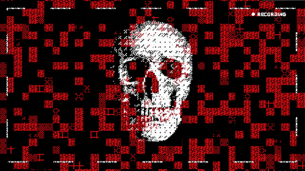

  

  
  
  
  

## Sobre mí

Me dedico a la **ciberseguridad ofensiva**: pentesting, investigación de vulnerabilidades y automatización de tareas de seguridad.

- 🎯 **HackTheBox:** Top 3 de Chile.
- 🧪 **Pro Labs completados:** Mythical y Puppet.
- 🛠️ **Construyo** herramientas propias de OSINT, threat intel y SOC sobre Telegram.
- 🐧 **Trabajo en** Arch Linux con bspwm, y uso Kali y Parrot para laboratorios.
- 📚 **Aprendiendo:** Red Team, explotación y análisis de malware.

> Todo el material publicado tiene fines **educativos y de auditoría ética**.

 

  

## Certificaciones

| Certificación | Emisor | Fecha | Estado |
|:--|:--|:--|:--|
|  **Mythical** · Pro Lab | Hack The Box | Nov 2026 | ✅ Verificado |
|  **Puppet** · Pro Lab | Hack The Box | Nov 2026 | ✅ Verificado |

## Proyectos destacados

  
  
  

## Stack

  

  
  
  
  
  
  

## Estadísticas

  
  

  

## Contacto

  
  
  
  

  

