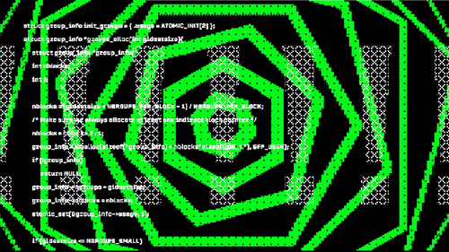

<!-- Encabezado -->

  

  

  
  
  
  

## 💀 Sobre mí

¡Bienvenido a mi GitHub! Me dedico a la **ciberseguridad ofensiva, el pentesting y la investigación de vulnerabilidades**. Suelo crear herramientas automatizadas para facilitar tareas de seguridad, auditar aplicaciones y sistemas, y resolver retos en entornos CTF y laboratorios.

  

> ⚠️ Todo el material publicado tiene fines **estrictamente educativos y de auditoría ética**. No me hago responsable del mal uso que terceros puedan darle a las herramientas.

## 🏆 Certificaciones

  
  

| Certificación | Emisor | Fecha | Estado |
|:--|:--|:--|:--|
| **Mythical** · Pro Lab | Hack The Box | Nov 2026 | ✅ Verificado |
| **Puppet** · Pro Lab | Hack The Box | Nov 2026 | ✅ Verificado |

## 🛠️ Proyectos destacados

  
  
  

## 🧰 Arsenal

  

  
  
  
  
  

## 📊 Estadísticas

  
  

  

## 📡 Contacto

  
  
  
  

  

